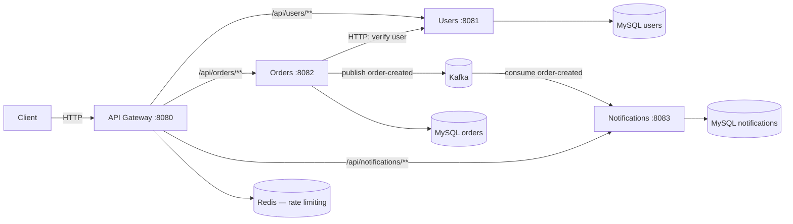

# Micro-Service Demo

## Overview

This repository contains a **micro‑service architecture** built with **Spring Boot 4.1** and **Maven**. It demonstrates how to structure multiple independent services that communicate via an **API gateway** (synchronous HTTP/REST) and via **Kafka** (asynchronous, event‑driven messaging), all orchestrated with Docker Compose.

The project consists of four services:

- **gateway** – API gateway (Spring Cloud Gateway) that is the single public entry point and routes requests to the downstream services. Also applies Redis‑backed rate limiting and CORS.
- **users** – CRUD operations for user management (MySQL).
- **orders** – Order creation, updates, and querying (MySQL). Verifies the customer by calling the users service over HTTP, and **publishes** an `order-created` event to Kafka.
- **notifications** – **Consumes** `order-created` events from Kafka and persists a notification; also exposes a small REST API for reading notifications (MySQL).

Each service lives in its own module with its own `pom.xml`, `Dockerfile`, and `src/` directory.

## Architecture



### Communication patterns

- **Synchronous (HTTP via the gateway):** all external traffic enters through the gateway on port `8080` and is routed by path prefix to the matching service.
- **Synchronous (service‑to‑service):** the orders service calls the users service directly (Spring HTTP interface client) to verify the customer when creating an order.
- **Asynchronous (Kafka):** when an order is created, orders publishes an `OrderCreatedEvent` to the `order-created` topic. The notifications service consumes that topic and stores a notification. Only orders **produces** and only notifications **consumes** — the gateway and users service are not involved in messaging.

#### Event payload (`order-created`)

```json
{ "orderId": 17, "userId": 1, "eventType": "ORDER_CREATED", "product": "Widget (+2 more)" }
```

## Port Map

| Service       | Port  | Gateway route prefix     |
|---------------|-------|--------------------------|
| gateway       | 8080  | (public entry point)     |
| users         | 8081  | `/api/users/**`          |
| orders        | 8082  | `/api/orders/**`         |
| notifications | 8083  | `/api/notifications/**`  |

Infrastructure: Kafka `9092`, Redis `6379`, MySQL (users `3306`, orders `3307`, notifications `3310` on the host when using the root compose).

## Project Structure

All business services share the same layered package structure (the orders module is the reference layout):

```
com.<service>
├── controller      REST endpoints
├── dto             request/response objects
├── entity          JPA entities
├── exception       ResourceNotFoundException + GlobalExceptionHandler
├── repository      Spring Data JPA repositories
└── service         service interface
    └── impl         service implementation
```

Service‑specific packages are added where needed:

- **orders** – `event` (Kafka producer + `OrderCreatedEvent`) and `client` (HTTP interface client to the users service).
- **notifications** – `consumer` (Kafka listener) and `aspect` (cross‑cutting logging).
- **gateway** – a routing/infrastructure service, so it has no entity/repository/service layers; it holds the `GatewayApplication` and its `KeyResolver` bean, with routes defined in `application.yml`.

## Prerequisites

- **Java 21** (LTS) — all modules target Java 21
- **Maven 3.9+** (or use the bundled `./mvnw` wrapper)
- **Docker** & **Docker Compose** (for the containerised run)
- **Git**

## Building the Services

From the project root, build a module with its wrapper, e.g. the *orders* service:

```bash
cd orders
./mvnw clean package -DskipTests
```

The generated JAR files are located under `target/` of each module.

## Running with Docker Compose (recommended)

A root `docker-compose.yml` orchestrates the full stack — all four services plus their MySQL databases, Kafka, and Redis — using Docker service‑name hostnames (no reliance on `localhost` between containers):

```bash
docker compose up --build
```

Everything is reachable through the gateway at `http://localhost:8080`.

Stop the stack:

```bash
docker compose down
```

Each service also ships an individual compose file for running that service with just its own dependencies.

## Running Locally (without Docker)

Start the required infrastructure (MySQL, Kafka, Redis) first, then run each service in its own terminal:

```bash
cd users         && ./mvnw spring-boot:run   # :8081
cd orders         && ./mvnw spring-boot:run   # :8082
cd notifications  && ./mvnw spring-boot:run   # :8083
cd gateway        && ./mvnw spring-boot:run   # :8080
```

All downstream hosts, ports, datasource URLs, and Kafka/Redis endpoints are **environment‑variable overridable**, defaulting to `localhost` for local runs (see each `application.properties` / the gateway `application.yml`).

## Example Requests (via the gateway)

```bash
# Create a user
curl -X POST http://localhost:8080/api/users \
  -H 'Content-Type: application/json' \
  -d '{"firstName":"Ada","lastName":"Lovelace","email":"ada@example.com"}'

# Create an order (triggers an order-created event -> a notification)
curl -X POST http://localhost:8080/api/orders \
  -H 'Content-Type: application/json' \
  -d '{"userId":1,"customerEmail":"ada@example.com","items":[{"productName":"Widget","quantity":2,"unitPrice":9.99}]}'

# Read the resulting notifications
curl http://localhost:8080/api/notifications
```

## Testing

Each module contains tests under `src/test`. Run them for a module with:

```bash
cd users && ./mvnw test
```

## Contributing

1. Create a feature branch (`git checkout -b feature/awesome-feature`).
2. Commit your changes and push.
3. Open a Pull Request targeting the `main` branch.

Please keep new services consistent with the shared package structure described above.

## License

This project is licensed under the **MIT License** – see the `LICENSE` file for details.
